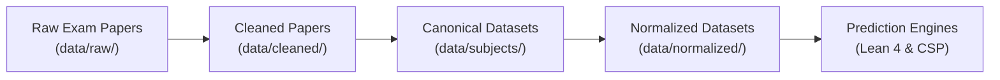

# Question Paper Predictor

An automated data engineering and machine learning pipeline to ingest, extract, clean, categorize, normalize, and predict university examination question papers for Jawaharlal Nehru Technological University Hyderabad (**JNTUH**) across **R13, R15, R16, R18, and R22** regulations.

---

## 1. Project Mission & Pipeline Overview

The pipeline transforms raw university examination papers into canonical structured datasets and feeds them to constraint solvers and probabilistic prediction engines:



1. **Ingestion & Extraction**: Ingest examination papers from PDF and OCR scans across years and semesters.
2. **Text Regularization**: Strip boilerplate headers, invigilator instructions, and kerning defects.
3. **Mathematical Preservation**: Preserve standard Unicode mathematical formulas and map Private Use Area (PUA) font glyphs.
4. **Diagram Mapping**: Link complex 2D figures and circuits to verified image crops in `data/images/`.
5. **Canonical Subject Assembly**: Assemble complete, 8-column per-subject datasets in `data/subjects/`.
6. **Normalization & Blueprint Solving**: Calibrate questions to examination marks slots (`PART_A_1M`, `PART_B_5M`) in `data/normalized/` for prediction engines.

---

## 2. Repository Layout

```text
question-paper-predictor/
├── README.md                    # Project overview & architectural guide
├── AGENTS.md                    # Agent operational directives & schema contracts
├── run_pipeline.py              # Master pipeline runner & integrity audit tool
│
├── data/                        # Single Source of Truth for Data
│   ├── README.md                # Detailed dataset catalog, schema contract, and progress tracker
│   ├── subjects/                # Canonical 8-column subject datasets (35 active subjects)
│   ├── normalized/              # Normalized slot-partitioned datasets for prediction engines
│   ├── images/                  # Extracted and verified diagram assets
│   ├── syllabi/                 # Topic vocabulary & syllabus specifications
│   │   ├── configs/             # Regulation JSON mappings (R13, R15, R16, R18, R22)
│   │   └── references/          # Official curriculum Markdown syllabi
│   ├── raw/                     # Original text & binary PDF papers
│   └── cleaned/                 # Regularized, boilerplate-stripped papers
│
├── docs/                        # Architecture specifications and technical guides
├── scripts/                     # Automated data processing, builders, and audit tools
│   ├── audit_datasets.py        # Strict 8-column schema verification suite
│   ├── build_*_canonical.py     # Subject-specific canonical dataset builders
│   └── extract_images.py        # Diagram extractor & PDF bounding-box cropper
│
├── src/                         # Modular core pipeline
│   ├── parser.py                # Question paper parser & atomic segmenter
│   ├── tagger.py                # SentenceTransformer topic & Bloom tagger
│   └── deduplicator.py          # Union-Find semantic question deduplicator
│
└── tools/                       # Web crawlers and PDF conversion utilities
```

---

## 3. Quick Start & Verification

### Prerequisites
- Python 3.9+
- Dependencies: `pip install pymupdf sentence-transformers numpy`

### Run Dataset Audit
Verify the integrity of all canonical datasets in `data/subjects/`:
```bash
python3 run_pipeline.py
# or directly:
python3 scripts/audit_datasets.py
```

### Dataset Standards
All subject datasets follow the strict **8-Column Canonical Schema**:
```text
subject_name, raw_question_text, topic_tag, bloom_level, original_marks, part_a_years, part_b_years, image_path
```

For detailed column descriptions, topic tag rules, and the complete 35-subject catalog, see **[`data/README.md`](data/README.md)**.
