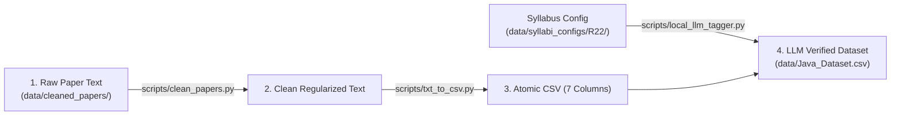

# Directory Structure & Data Storage Specifications

## 1. Project Directory Layout

The repository uses a segregated hierarchy to manage datasets, pipeline scripts, syllabus definitions, and documentation:

```text
question-paper-predictor/
├── README.md                                    # Project overview
├── docs/                                        # Architecture & onboarding guides
│   ├── dataset_design_and_fields.md             # Confirmed 7-field schema specification
│   ├── pipeline_architecture.md                 # End-to-end pipeline architecture & rules
│   ├── subject_onboarding_guide.md              # Parallel execution SOP for team members
│   ├── data_cleaning_guide.md                   # Text normalization, en-dash, and kerning rules
│   ├── setup_and_run.md                         # Pipeline execution guide
│   └── directory_structure_and_storage.md       # Directory layout and data hierarchy
│
├── data/                                        # Canonical Data Root (Single Source of Truth)
│   ├── datasets/                                # Validated Production Datasets (29 Subject CSVs)
│   │   ├── Advanced_Algorithms_Dataset.csv
│   │   ├── Artificial_Intelligence_Dataset.csv
│   │   └── ... (all 29 subject datasets)
│   ├── syllabi/                                 # Official syllabi references & configs
│   │   ├── R22_CSE_Syllabus.md
│   │   └── configs/                             # Regulation-wise JSON configs (R13, R15, R16, R18, R22)
│   ├── excluded/                                # Filtered questions & figure-dependent archives
│   │   ├── Advanced_Algorithms_excluded.csv
│   │   └── ...
│   └── raw/                                     # Raw crawled inputs & OCR txt (gitignored)
│       ├── extracted_text/
│       └── pdfs/
│
├── Training_Data/                               # Independent model training datasets (Untouched)
│   └── dbms_os_se_train.csv
│
├── scripts/                                     # Automated data collection & QA pipeline tools
│   ├── audit_datasets.py                        # Automated integrity & quality validation suite
│   ├── clean_all_datasets.py                    # Master dataset standardization & cleaning pipeline
│   ├── clean_papers.py                          # Boilerplate stripper and text regularizer
│   ├── txt_to_csv.py                            # Question segmentation and mark extraction
│   ├── local_llm_tagger.py                      # Local LLM syllabus & Bloom classifier (Ollama)
│   └── extract_images.py                        # Diagram and equation extractor
│
├── src/                                         # Core parsing, tagging, and deduplication modules
└── tools/                                       # Scraping and batch extraction tools
    ├── pdf_to_txt.py                            # PDF to text converter
    └── qpaper_scraper.py                        # Selenium-based crawler
```

---

## 2. File Naming Conventions

### 2.1 Cleaned Question Paper Text Files
Cleaned exam text files are stored under:
```text
data/cleaned_papers/[Regulation]_[text]/Question Papers/[Year-Sem]/[SubjectName]/[ExamSession].txt
```
* **Example:** `data/cleaned_papers/R16_text/Question Papers/2-1/2-1/OBJECT ORIENTED PROGRAMMING THROUGH JAVA/AprilMay - 2018.txt`

### 2.2 Master Syllabus JSON Files
Syllabus configuration files must be stored as:
```text
data/syllabi_configs/R22/[SubjectName]_syllabus.json
```
* **Example:** `data/syllabi_configs/R22/Java_syllabus.json`

---

## 3. Data Processing Flow


