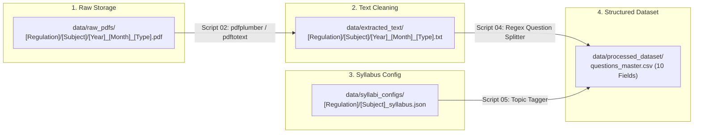

# Directory Structure & Data Storage Specifications

## 1. Project Directory Layout

To coordinate 45 contributors across 9 teams without merge conflicts or data overlap, the project uses a strictly segregated directory hierarchy:

```text
question-paper-predictor/
├── README.md                                    # Main project overview and team roadmap
├── problem_descrption_v1.md                     # Initial problem statement
├── docs/                                        # Architecture & design specifications
│   ├── dataset_design_and_fields.md             # The 10 decided fields & design decisions
│   ├── data_crawling_and_sources.md             # Portal crawling & ingestion mechanisms
│   ├── directory_structure_and_storage.md       # This file: Directory & naming rules
│   └── syllabus_parsing_and_tagging_guide.md    # Strict syllabus extraction & taxonomy guide
│
├── data/                                        # Data assets (gitignored for large binaries)
│   ├── raw_pdfs/                                # Immutable raw PDF files downloaded from portal/drive
│   │   ├── R13/
│   │   ├── R15/
│   │   ├── R16/
│   │   ├── R18/
│   │   │   ├── 1st_Year/
│   │   │   ├── 2nd_Year/
│   │   │   ├── 3rd_Year/
│   │   │   └── 4th_Year/
│   │   └── R22/
│   │       ├── Question_paper/
│   │       └── Syllabus/
│   │
│   ├── extracted_text/                          # Intermediate text files (PDF -> TXT)
│   │   └── [Regulation]/[Subject]/
│   │       └── [Exam_Session].txt               # Cleaned of watermarks, headers, and boilerplate
│   │
│   ├── syllabi_configs/                         # Master syllabus JSON files per subject
│   │   └── [Regulation]/
│   │       └── [Subject]_syllabus.json          # Parsed units, categories, and topic tags
│   │
│   └── processed_dataset/                       # Final structured tabular datasets
│       ├── questions_master.csv                 # Master dataset with the 10 decided fields
│       ├── questions_master.parquet             # High-performance columnar format for ML/Lean
│       └── subject_registry.json                # Normalization dictionary for subject names/aliases
│
├── scripts/                                     # Automated pipeline tools
│   ├── 01_crawler.py                            # Crawls JNTUH OSS portal
│   ├── 02_pdf_to_text.py                        # Text extraction and noise removal
│   ├── 03_parse_syllabus.py                     # Extracts units, categories, and topics from syllabus PDFs
│   ├── 04_segment_questions.py                  # Splits text into atomic questions with marks
│   └── 05_tag_and_export.py                     # Matches topic tags and exports final CSV
│
├── engine/                                      # Lean 4 constraint solver & verification core
└── ui/                                          # Elixir + Phoenix LiveView web dashboard
```

---

## 2. File Naming Conventions

### 2.1 Raw Question Paper PDFs
Raw exam files must strictly follow this naming syntax:
```text
[SubjectName]_[Year]_[Month]_[ExamType].pdf
```
* **Examples:**
  - `DataStructures_2019_Nov_Regular.pdf`
  - `DataStructures_2021_May_Supply.pdf`
  - `DBMS_2022_Nov_Regular.pdf`

* **Allowed Values:**
  - `[Year]`: 4-digit calendar year (`2009` through `2024`).
  - `[Month]`: `Nov` (for Winter/Odd Semester exams) or `May` (for Summer/Even Semester exams).
  - `[ExamType]`: `Regular` or `Supply`.

### 2.2 Intermediate Cleaned Text Files
When a PDF is converted and cleaned of watermarks and university headers, it is stored as:
```text
data/extracted_text/[Regulation]/[SubjectName]/[Year]_[Month]_[ExamType].txt
```

### 2.3 Master Syllabus JSON Files
Syllabus configs must be stored as:
```text
data/syllabi_configs/[Regulation]/[SubjectName]_syllabus.json
```
* **Example:** `data/syllabi_configs/R22/Data_Structures_syllabus.json`

---

## 3. Data Flow Between Teams



---

## 4. Git Versioning Guidelines

To prevent the Git repository from becoming bloated:
1. **Raw PDFs (`.pdf`):** Tracked externally on Google Drive (`Paper Prediction Dataset`). Kept in `.gitignore` on the Git repo.
2. **Intermediate text dumps (`.txt`):** Kept in `.gitignore`.
3. **Structured data (`.json`, `.csv`, `.parquet`):** **Tracked in Git** under `data/processed_dataset/` and `data/syllabi_configs/`.
4. **Code & Documentation:** Tracked in Git under `scripts/`, `docs/`, `engine/`, and `ui/`.
