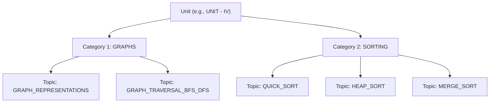

# Syllabus Parsing, Normalization & Topic Tagging Guide

## 1. Golden Rule for Topic Categories

> [!IMPORTANT]
> **Never invent topic category names.** All `topic_category` tokens must be extracted **strictly from the bold/colon headers printed inside the official JNTUH syllabus PDF**.

Every JNTUH syllabus defines a unit with major section headers followed by a colon (`:`). For example, from the official **R22 Data Structures Syllabus PDF**:

```text
UNIT - II
Dictionaries: linear list representation, skip list representation, operations - insertion, deletion and searching.
Hash Table Representation: hash functions, collision resolution-separate chaining, open addressing-linear probing, quadratic probing, double hashing, rehashing, extendible hashing.
```

From this text, the strict category and topic extraction is:
- **Category 1:** `DICTIONARIES`
  - *Topics:* `LINEAR_LIST_REPRESENTATION`, `SKIP_LIST_REPRESENTATION`, `DICTIONARY_OPERATIONS`
- **Category 2:** `HASH_TABLE_REPRESENTATION`
  - *Topics:* `HASH_FUNCTIONS`, `COLLISION_RESOLUTION_CHAINING`, `OPEN_ADDRESSING_LINEAR_PROBING`, `QUADRATIC_PROBING`, `DOUBLE_HASHING`, `REHASHING`, `EXTENDIBLE_HASHING`

---

## 2. The 3-Tier Hierarchy

To prevent paper setters from pairing two identical questions in Part B internal choice (`Q2 OR Q3`), questions are classified across 3 tiers:



* **Why this matters for the prediction engine:**
  JNTUH paper setters follow this exact syllabus partition. In Unit IV, they will place:
  - **Question A:** from Category 1 (`GRAPHS`)
  - **OR**
  - **Question B:** from Category 2 (`SORTING`)
  
  Our engine uses this structure to guarantee orthogonal internal choices.

---

## 3. Subject Name Normalization Registry

Over 15 years, JNTUH frequently modified subject titles. The `subject_registry.json` standardizes them:

```json
{
  "SUBJECT_DBMS": {
    "canonical_name": "Database Management Systems",
    "aliases": [
      "dbms",
      "data base management systems",
      "database management systems",
      "database engineering",
      "advanced dbms"
    ],
    "codes": ["CS302ES", "CS304PC", "CS403PC", "A40503", "54016"]
  },
  "SUBJECT_DATA_STRUCTURES": {
    "canonical_name": "Data Structures",
    "aliases": [
      "ds",
      "data structures",
      "data structures through c",
      "advanced data structures",
      "ads"
    ],
    "codes": ["CS301PC", "CS201ES", "A30502"]
  },
  "SUBJECT_DISCRETE_MATH": {
    "canonical_name": "Discrete Mathematics",
    "aliases": [
      "dm",
      "dms",
      "discrete mathematics",
      "discrete mathematical structures",
      "mfcs",
      "mathematical foundations of computer science"
    ],
    "codes": ["CS303PC", "MA301BS", "A30501"]
  }
}
```

---

## 4. Standard Format for Syllabus Config Files

Each subject's extracted syllabus must be saved as `data/syllabi_configs/[Regulation]/[Subject]_syllabus.json`:

```json
{
  "subject_name": "Data Structures",
  "canonical_id": "SUBJECT_DATA_STRUCTURES",
  "regulation": "R22",
  "year": "II",
  "sem": "I",
  "units": {
    "UNIT_1": {
      "categories": {
        "LINEAR_LISTS": ["SINGLY_LINKED_LIST", "LIST_OPERATIONS"],
        "STACKS": ["STACK_OPERATIONS", "ARRAY_AND_LINKED_STACKS", "STACK_APPLICATIONS"],
        "QUEUES": ["QUEUE_OPERATIONS", "CIRCULAR_QUEUE"]
      }
    },
    "UNIT_2": {
      "categories": {
        "DICTIONARIES": ["LINEAR_LIST_REPRESENTATION", "SKIP_LIST_REPRESENTATION"],
        "HASH_TABLE_REPRESENTATION": [
          "HASH_FUNCTIONS",
          "COLLISION_RESOLUTION_CHAINING",
          "OPEN_ADDRESSING_LINEAR_PROBING",
          "QUADRATIC_PROBING",
          "DOUBLE_HASHING",
          "REHASHING",
          "EXTENDIBLE_HASHING"
        ]
      }
    },
    "UNIT_3": {
      "categories": {
        "SEARCH_TREES": ["BINARY_SEARCH_TREES", "B_TREES", "B_PLUS_TREES"],
        "AVL_TREES": ["AVL_TREE_DEFINITION", "HEIGHT_OF_AVL", "AVL_ROTATIONS"],
        "SPECIAL_TREES": ["RED_BLACK_TREES", "SPLAY_TREES"]
      }
    },
    "UNIT_4": {
      "categories": {
        "GRAPHS": ["GRAPH_IMPLEMENTATION", "GRAPH_TRAVERSAL_BFS_DFS"],
        "SORTING": ["QUICK_SORT", "HEAP_SORT", "EXTERNAL_SORTING", "MERGE_SORT"]
      }
    },
    "UNIT_5": {
      "categories": {
        "PATTERN_MATCHING": ["BRUTE_FORCE", "BOYER_MOORE", "KNUTH_MORRIS_PRATT_KMP"],
        "TRIES": ["STANDARD_TRIES", "COMPRESSED_TRIES", "SUFFIX_TRIES"]
      }
    }
  }
}
```

---

## 5. Team Checklist for Phase 4 Verification

When tagging historical questions to this syllabus:
1. Identify the subject and match it to `subject_name` using `subject_registry.json`.
2. Clean question text of sub-question labels (`Q3 a)` $\to$ strip label, keep body).
3. Assign the nearest `topic_tag` matching the concepts defined in the master syllabus JSON.
4. Set `question_tier`:
   - `Short` for 1–3 marks.
   - `Long` for 5–10 marks.
5. Set `bloom_level`:
   - `Remember` for direct definitions (*"Define Skip List"*).
   - `Understand` for explanations (*"Explain collision resolution"*).
   - `Apply` / `Analyze` for numerical tracing, algorithm step-throughs, or design questions (*"Construct an AVL tree for values [10, 20, 30]"*).
